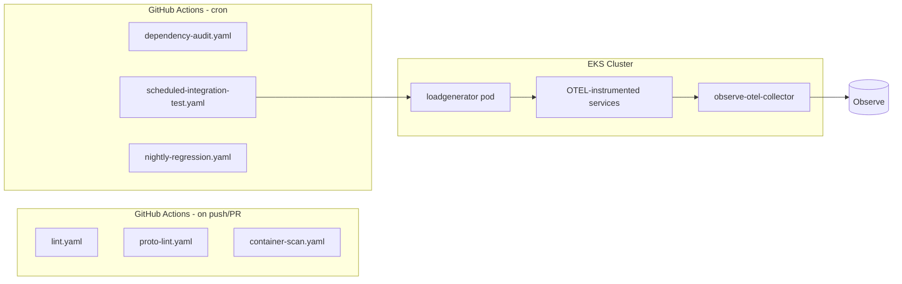

# Plan: Standard CI/CD Workflows for Online Boutique

## Context

### What already exists
The repo has 8 GitHub Actions workflows, but they leave significant gaps:
- `ci-pr.yaml` / `ci-main.yaml` — unit tests (Go + C# only) + deploy to GKE staging + smoke test
- `push-deploy.yaml` — builds all images to GCR on main push
- Validation-only jobs for Helm, Kustomize, Terraform, Kubernetes manifests

### What is missing (gap analysis)
| Gap | Impact |
|-----|--------|
| No linting for any language | Code style drift across 5 languages, no CI gate |
| No security scanning | No CVE detection in CI for any service image |
| No dependency vulnerability audit | npm/pip/Go/NuGet deps not checked for known vulns |
| No proto validation | Breaking API changes not caught until runtime |
| No scheduled integration test | Only tested on push; no continuous regression signal |
| No nightly deeper test run | Flaky or slow tests excluded from PR gate |

### Data flow into Observe
The scheduled integration test (job 5) is the primary source of continuous OTEL telemetry because it drives real Locust traffic through the OTEL-instrumented services running on EKS. The other jobs generate CI/CD event data (build results, scan findings, dependency reports) as a secondary signal.



---

## The six workflows

### 1. `lint.yaml` — Multi-language linting

**Trigger:** `pull_request` to `main` + `push` to `main`

Runs four parallel jobs (one per language group) so failures are isolated and fast:

**Job: `lint-go`**
- `actions/setup-go@v5` with Go 1.22
- Install `golangci-lint` (latest stable via the official installer action)
- Run `golangci-lint run ./...` in each of: `src/frontend`, `src/checkoutservice`, `src/productcatalogservice`, `src/shippingservice`
- Default linters only (no `.golangci.yml` exists, so we add a minimal one as part of this change)
- Minimal `.golangci.yml` at repo root: enable `errcheck`, `govet`, `staticcheck`, `gosimple`, `ineffassign`

**Job: `lint-python`**
- `actions/setup-python@v5` with Python 3.11
- `pip install ruff`
- `ruff check src/emailservice src/recommendationservice src/loadgenerator`
- No `pyproject.toml` exists, so a minimal `ruff.toml` or inline `--select E,W,F` flag (no config file change needed for a first pass)

**Job: `lint-node`**
- `actions/setup-node@v4` with Node 20
- `npm install -g eslint`
- Add a minimal `.eslintrc.json` to `src/currencyservice` and `src/paymentservice` (ES2022, no-unused-vars, no-undef)
- `eslint src/currencyservice src/paymentservice --ext .js`

**Job: `lint-dotnet`**
- `actions/setup-dotnet@v4` with .NET 8
- `dotnet format src/cartservice/ --verify-no-changes`
- This checks C# formatting without fixing it, which is the correct CI gate behavior

**Path filter:** use `dorny/paths-filter` so only the changed language's job is required to pass on PRs (avoids blocking a Python-only PR because Go lint failed on unrelated code).

---

### 2. `proto-lint.yaml` — Proto validation + breaking change detection

**Trigger:** `pull_request` to `main` + `push` to `main`, scoped to `protos/**`

**Steps:**
1. `bufbuild/buf-setup-action@v1.50` — installs the `buf` CLI
2. `buf lint protos/` — enforces proto style (default `buf` lint rules: field naming, enum prefixes, etc.)
3. On PRs only: `buf breaking protos/ --against '.git#branch=main'` — detects breaking API changes (removed fields, type changes, renamed RPCs)
4. Add a minimal `buf.yaml` to `protos/` as part of this change (required for `buf` to run): `version: v2`, `lint: {use: [DEFAULT]}`, `breaking: {use: [WIRE_COMPATIBLE]}`

**Why:** The repo has 10 gRPC services sharing a single `demo.proto`. A breaking change to any RPC would silently break inter-service communication — there is currently nothing catching this.

---

### 3. `container-vulnerability-scan.yaml` — Trivy image scanning

**Trigger:** `push` to `main` + `schedule: '0 6 * * 1'` (weekly Monday 06:00 UTC)

Scans all 10 service images for known CVEs. Uses a matrix strategy so each image is scanned in parallel and results are uploaded to the GitHub Security tab as SARIF.

**Steps (matrix over all 10 services):**
1. `docker/setup-buildx-action`
2. `docker/build-push-action` with `push: false, load: true` — build image locally, do not push
3. `aquasecurity/trivy-action` with `format: sarif, output: trivy-results.sarif, severity: CRITICAL,HIGH, exit-code: 0` (non-blocking scan; findings go to Security tab, not a hard failure — a hard failure can be added later once baseline is established)
4. `github/codeql-action/upload-sarif`

**Note:** `exit-code: 0` is intentional for a first rollout. Once teams baseline and triage existing CVEs, it can be changed to `exit-code: 1` on `CRITICAL` only.

---

### 4. `dependency-audit.yaml` — Cross-ecosystem vulnerability audit

**Trigger:** `schedule: '0 8 * * 3'` (weekly Wednesday 08:00 UTC) + `workflow_dispatch`

Audits all dependency trees for known vulnerabilities across all five language ecosystems. Each language runs as a parallel job.

**Job: `audit-go`**
- `go install golang.org/x/vuln/cmd/govulncheck@latest`
- Run `govulncheck ./...` in each of the four Go service directories
- `govulncheck` checks the actual call graph, not just the dep list, so it only flags reachable vulns

**Job: `audit-node`**
- `npm audit --audit-level=high` in `src/currencyservice` and `src/paymentservice`
- Fails if any HIGH or CRITICAL advisories exist with a fix available

**Job: `audit-python`**
- `pip install pip-audit`
- `pip-audit -r src/emailservice/requirements.txt`
- `pip-audit -r src/recommendationservice/requirements.txt`
- `pip-audit -r src/loadgenerator/requirements.txt`

**Job: `audit-dotnet`**
- `dotnet list src/cartservice/ package --vulnerable --include-transitive`
- Fails if `stdout` contains "has the following vulnerable packages"

**Job: `audit-java`**
- Run `./gradlew dependencyCheckAnalyze` in `src/adservice/` using the OWASP Dependency-Check Gradle plugin
- Upload the resulting HTML report as a workflow artifact

**Summary step:** After all jobs, a final job aggregates exit codes and posts a job summary table to the GitHub Actions summary view.

---

### 5. `scheduled-integration-test.yaml` — Scheduled Locust integration test

**Trigger:** `schedule: '0 */6 * * *'` (every 6 hours) + `workflow_dispatch` with `duration` and `users` inputs

This is the main continuous data generation job. It runs the existing Locust load generator against the live EKS deployment for a fixed window, then validates error rates against a threshold. Because the services are OTEL-instrumented, every Locust request generates distributed traces, structured logs, and metrics that flow through the `observe-otel-collector` into Observe.

**Steps:**
1. `aws-actions/configure-aws-credentials@v4` using `AWS_ACCESS_KEY_ID`, `AWS_SECRET_ACCESS_KEY`, `AWS_REGION` secrets
2. `aws eks update-kubeconfig --name ${{ secrets.EKS_CLUSTER_NAME }}`
3. Check that the `observe-otel-collector` DaemonSet is healthy; skip + warn if not (avoids noisy failures)
4. Ensure `loadgenerator` deployment exists (apply `deploy/observe/loadgenerator.yaml` if missing); wait for `Ready`
5. Delete and recreate the loadgenerator pod to get a clean stats baseline
6. Run for `$DURATION` seconds (default: 300 = 5 min) with `$USERS` concurrent users (default: 5)
7. Collect final stats from `kubectl logs -l app=loadgenerator --tail=5`
8. Parse aggregated request count + error count; fail if `error_rate > 5%`
9. Post the stats (total requests, errors, RPS, error rate) to the GitHub Actions job summary

**`workflow_dispatch` inputs:**
```yaml
inputs:
  duration:
    description: 'Test duration in seconds'
    default: '300'
  users:
    description: 'Concurrent Locust users'
    default: '5'
```

**Why this generates continuous Observe data:** Locust drives the `browseProduct` (weight 10), `addToCart` (2), `viewCart` (3), `checkout` (1), `setCurrency` (2) task set. Each request crosses 3–8 service boundaries and produces distributed traces, OTEL logs with `trace_id` correlation, and RED metrics (Rate, Errors, Duration) for every service in the topology.

**Required secrets:** `AWS_ACCESS_KEY_ID`, `AWS_SECRET_ACCESS_KEY`, `AWS_REGION`, `EKS_CLUSTER_NAME`

---

### 6. `nightly-regression.yaml` — Nightly full test suite

**Trigger:** `schedule: '0 2 * * *'` (nightly at 02:00 UTC) + `workflow_dispatch`

Runs a more complete version of the PR unit test suite plus image build verification. The nightly cadence makes this appropriate for things that are too slow or resource-intensive for every PR.

**Job: `go-tests-full`**
- Run `go test -race -count=1 ./...` in all four Go services (not just the two in `ci-main.yaml`)
- The `-race` flag catches data races that the current CI misses; `-count=1` disables test result caching

**Job: `csharp-tests`**
- `dotnet test src/cartservice/ --logger "console;verbosity=detailed" --collect:"XPlat Code Coverage"`
- Upload coverage report as artifact (Coverlet XML)

**Job: `go-build-all`**
- `go build ./...` in all four Go services — catches compile errors from dependency updates that don't touch tested paths

**Job: `docker-build-verify`**
- Build (but do not push) all 10 service images for `linux/amd64`
- Verifies Dockerfiles are still valid after upstream base image changes or dep bumps
- Uses `docker/build-push-action` with `push: false`

**Summary step:** Post a table of pass/fail + coverage for each job to the GitHub Actions summary.

---

## Required secrets

| Secret | Used by |
|--------|---------|
| `AWS_ACCESS_KEY_ID` | job 5 |
| `AWS_SECRET_ACCESS_KEY` | job 5 |
| `AWS_REGION` | job 5 |
| `EKS_CLUSTER_NAME` | job 5 |

Jobs 1–4 and 6 use only GitHub-hosted runners with no external secrets.

---

## New config files required

Each of these is small and added as part of the relevant workflow's initial implementation:

| File | Required by | Content |
|------|-------------|---------|
| `.golangci.yml` (root) | `lint.yaml` job 1 | Minimal: `errcheck`, `govet`, `staticcheck` |
| `protos/buf.yaml` | `proto-lint.yaml` | `version: v2`, default lint + `WIRE_COMPATIBLE` breaking |
| `src/currencyservice/.eslintrc.json` | `lint.yaml` job 3 | ES2022 env, no-unused-vars, no-undef |
| `src/paymentservice/.eslintrc.json` | `lint.yaml` job 3 | Same as above |

---

## Critical files

- [`.github/workflows/ci-main.yaml`](.github/workflows/ci-main.yaml) — Reference for existing runner labels and step patterns to match
- [`src/loadgenerator/locustfile.py`](src/loadgenerator/locustfile.py) — Defines the Locust task set driven by the integration test
- [`deploy/observe/loadgenerator.yaml`](deploy/observe/loadgenerator.yaml) — Kubernetes manifest applied in job 5
- [`protos/demo.proto`](protos/demo.proto) — The shared API definition validated by job 2
- [`src/cartservice/tests/cartservice.tests.csproj`](src/cartservice/tests/cartservice.tests.csproj) — Only existing test project; extended in job 6
